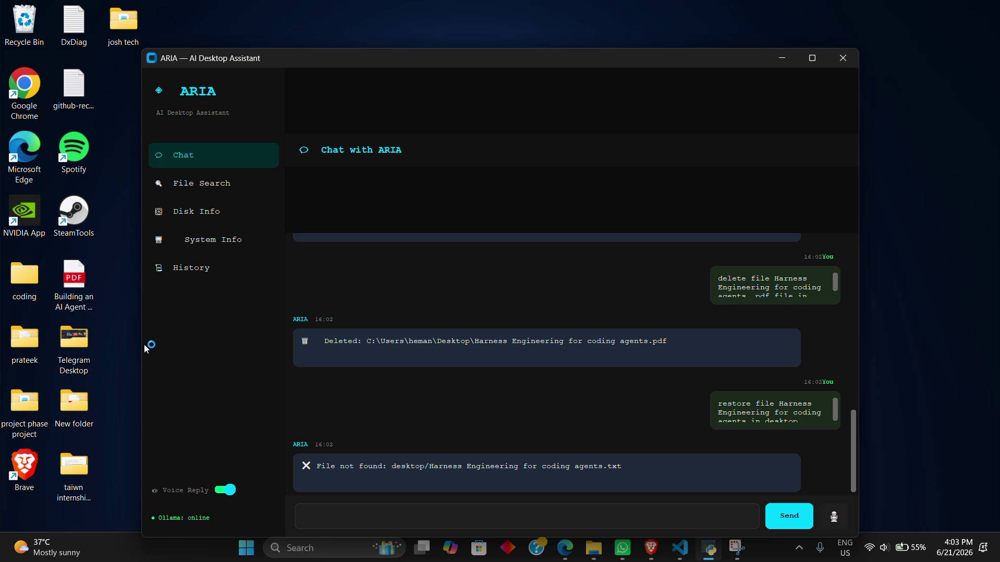

# Aria

Natural language meets local desktop automation.

**Focus:** AI Engineer / SDE  
**Stack:** Python · Ollama · CustomTkinter

[LinkedIn](https://www.linkedin.com/in/prateek-sharma-97a064296/) · [Portfolio projects](docs/PORTFOLIO.md)

## Project overview

ARIA voice and AI assistant.

## Interface preview



This screenshot shows a captured prototype session, rather than a new performance or runtime test.

## Engineering highlights

- Local Ollama inference for natural-language commands
- AI planner, execution router and system-tool modules
- Desktop GUI with speech input and spoken replies
- Included demo video: aria.mp4

## What I learned

I learned a lot by working through this project: reading code, troubleshooting integrations, comparing approaches, and understanding how individual components become a complete application. The main takeaways were:

- Using a local pretrained LLM for structured task planning.
- Translating model output into explicit tool actions and GUI feedback.
- Integrating Python speech libraries with an interactive desktop interface.

## Getting started

Run the following from the repository root in PowerShell. Install the required Python/Node.js runtimes first and use your own credentials where required.

```powershell
py -3.11 -m venv .venv
& .venv/Scripts/Activate.ps1
pip install -r requirements.txt
ollama pull llama3
# Start Ollama, then launch the GUI
python main.py
```

## Repository map

| Path | Contents |
|---|---|
| `ai.py` | Project source, documentation or configuration |
| `aria.mp4` | Project source, documentation or configuration |
| `engine.py` | Project source, documentation or configuration |
| `install.bat` | Project source, documentation or configuration |
| `main.py` | Project source, documentation or configuration |
| `requirements.txt` | Project source, documentation or configuration |
| `tools.py` | Project source, documentation or configuration |
| `voice.py` | Project source, documentation or configuration |

## Project status

This is a development or study snapshot. Source import and upload checks are separate from runtime validation; the application and model behavior have not been retested as part of preparing this portfolio.

## Existing project documentation

<details>
<summary>Setup details, implementation notes and original documentation</summary>

# ◈ ARIA — AI Desktop Assistant

> "An AI-powered desktop assistant that interprets natural language commands and performs file system operations and application control using a local LLM."

---

## 🚀 Quick Start

### Step 1 — Install Ollama
Download and install from: https://ollama.com/download
Then open terminal and run:
```
ollama pull llama3
ollama serve
```

### Step 2 — Install Python Dependencies
Double-click `install.bat`  **OR** run in terminal:
```
pip install customtkinter==5.2.2 requests==2.31.0 SpeechRecognition==3.10.0 pyttsx3==2.90 psutil==5.9.8 Pillow==10.3.0
pip install pyaudio==0.2.14
```

### Step 3 — Run ARIA
```
python main.py
```

---

## 🧠 Architecture

```
User Input (Text / Voice)
        ↓
   ai.py → Ollama (llama3) → JSON Plan
        ↓
   engine.py → Execution Router
        ↓
   tools.py → Real System Action
        ↓
   main.py → GUI Display + TTS Reply
```

---

## 💬 Example Commands

| Command | What ARIA Does |
|---|---|
| `create folder myproject in desktop` | Creates folder on Desktop |
| `create file notes.txt in d drive` | Creates file on D: drive |
| `move notes.txt to downloads` | Moves file |
| `delete test.txt` | Deletes with confirmation |
| `open valorant` | Launches Valorant |
| `open vscode` | Launches VS Code |
| `list downloads` | Shows files in Downloads |
| `search resume.pdf` | Finds file anywhere on PC |
| `read file notes.txt` | Reads file content |
| `show disk info` | Shows all drive usage |
| `show system info` | CPU, RAM, OS info |
| `open google.com` | Opens in browser |
| `search python tutorial on google` | Google search |
| `create project folder then open vscode` | Multi-step automation |

---

## 🔥 Features

- ✅ Natural Language Understanding (no syntax needed)
- ✅ Local AI via Ollama — fully offline, private
- ✅ Multi-drive support (C, D, E drive)
- ✅ App launcher (Valorant, Brave, Chrome, VS Code…)
- ✅ Smart file search (Desktop → Known Folders → Full system)
- ✅ Multi-step automation workflows
- ✅ Browser automation (open URL, Google search)
- ✅ Voice input (microphone) + Voice output (TTS)
- ✅ Disk info with usage stats
- ✅ System info (CPU, RAM, OS)
- ✅ Memory system (logs all actions)
- ✅ Chat mode fallback (when no action detected)
- ✅ Beautiful dark GUI (CustomTkinter — no browser needed)
- ✅ Command history viewer
- ✅ Feedback system (learning foundation)

---

## ⚙️ Customize App Paths

Edit `tools.py` → `APP_PATHS` dictionary to match your system:
```python
APP_PATHS = {
    "valorant": r"C:\Riot Games\...",
    "brave":    r"C:\Users\YOUR_NAME\AppData\...",
    ...
}
```

---

## 📁 Project Structure

```
ARIA/
├── main.py          ← GUI (CustomTkinter desktop app)
├── engine.py        ← Execution router
├── ai.py            ← AI planner + chat + memory system
├── tools.py         ← File ops, system info, browser, search
├── voice.py         ← Speech-to-text + Text-to-speech
├── requirements.txt ← All dependencies
├── install.bat      ← One-click installer (Windows)
└── README.md        ← This file
```

---

## ⚠️ Troubleshooting

| Problem | Fix |
|---|---|
| "Ollama: offline" shown | Run `ollama serve` in terminal |
| Voice input not working | Install PyAudio via `install.bat` |
| App not launching | Edit `APP_PATHS` in `tools.py` |
| AI not responding | Make sure `ollama pull llama3` is done |


</details>
